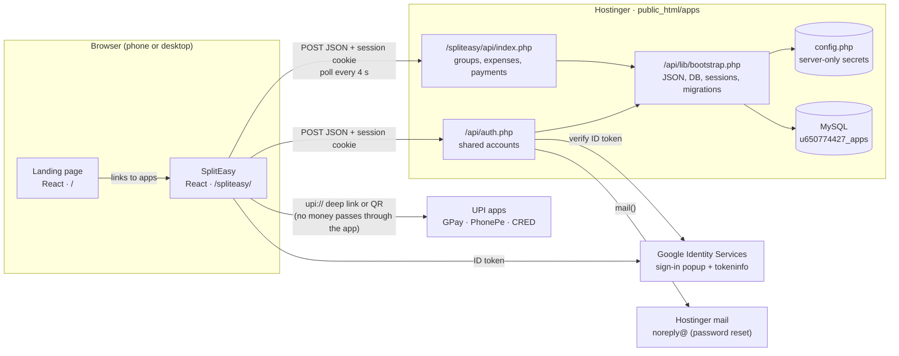
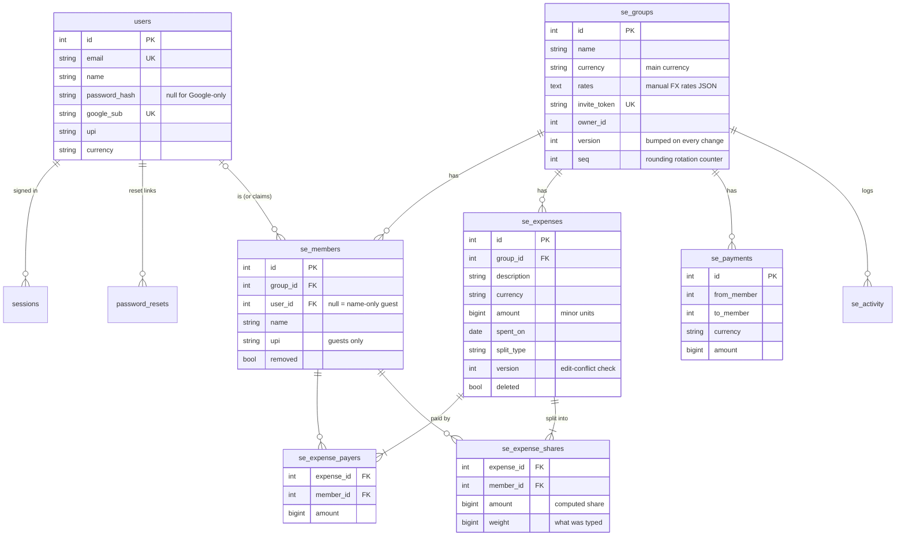

# my-apps

Small personal utility apps, served from **https://apps.ranjithkumarmadhavan.com**.

| App | URL | What it does |
| --- | --- | --- |
| Landing page | [`/`](https://apps.ranjithkumarmadhavan.com) | Lists every app by category (Money, Productivity, Travel, Utilities) |
| SplitEasy | [`/spliteasy/`](https://apps.ranjithkumarmadhavan.com/spliteasy/) | Splitwise-style expense splitting for trips and groups, with UPI settle-up |

## Architecture

Each app is a React single-page app built with Vite. It talks to a small PHP API on Hostinger shared hosting,
which stores data in one shared MySQL database. Sign-in is shared too: one account and one session cookie
work across every app on the subdomain.



### How a request flows

1. The browser loads static files (`index.html` plus hashed JS/CSS) from the subdomain folder. For SplitEasy,
   `.htaccess` sends every unknown path under `/spliteasy/` to `index.html`, so links like `/spliteasy/g/12`
   work on refresh. A tiny router in `src/lib/router.js` then picks the screen.
2. The app calls the API with `POST` JSON `{ action, ... }`. Every call must carry the header
   `X-Requested-With: fetch`. Browsers won't send that header cross-site without permission, so this plus the
   `SameSite=Lax` cookie protects against cross-site request forgery.
3. `lib/bootstrap.php` connects to MySQL, applies any pending schema steps, and finds the user from the
   `apps_session` cookie. Only a SHA-256 hash of the session token is stored, and it expires after 30 days
   (sliding).
4. The endpoint checks membership and validates input. It writes inside a transaction that locks the group
   row, so two people saving at once can't corrupt balances. Then it bumps the group's `version`.
5. The open group screen polls every 4 seconds while visible, sending its last `version`. The server replies
   `{ unchanged: true }` unless something changed, so polling stays cheap. Shared hosting has no WebSockets,
   which is why it polls.

### Sign-in

| Method | How it works |
| --- | --- |
| Email + password | `password_hash` / `password_verify`. Login is rate-limited (10 failures per email or 30 per IP in 15 minutes). |
| Google | The Google Identity Services button gives the browser an ID token. `auth.php` checks it with Google's `tokeninfo` endpoint (audience, issuer, expiry, verified email). It then signs in, links the account by email, or creates one. If Google signs in to an email account whose address was never verified, that account's password is removed so the Google owner controls it. |
| Forgot password | `auth.php` emails a one-hour, single-use link via PHP `mail()` from `noreply@`. The response is the same whether or not the email exists. |

### SplitEasy's money rules

- **Integers only.** Amounts are stored in the currency's minor unit (paise, cents; 0 decimals for JPY, 3 for
  KWD). There is no floating-point money.
- **Splits.** Equal, exact amounts, shares (2:1:1) or percentages. Leftover paise go to the largest
  remainders, and ties rotate by the expense's sequence number so the extra paisa doesn't always land on the
  same person. The same `allocate()` exists in `src/lib/money.js` and the PHP API, and they must stay
  identical.
- **Several payers per expense.** What each person paid must add up to the total.
- **Balances** are computed in the browser from the expense and payment lists, kept separate per currency.
  Optional manual group rates (`1 USD = 83.5 INR`) give a combined view in the group's main currency.
- **Settle-up** uses a greedy plan (largest debtor pays largest creditor), so N people need at most N−1
  payments.
- **Edit conflicts.** Each expense has a `version`. Saving an out-of-date copy returns HTTP 409 instead of
  overwriting someone else's change.
- **Guests.** People can be added by name with no account. Someone who opens the invite link can say "that's
  me" to take over that name's history.
- **UPI.** "Pay" buttons open GPay, PhonePe or CRED (Android intents or iOS app links) with the payee,
  amount and note filled in. Desktop shows a QR code instead. The payer still confirms in their own app, and
  then taps "Record payment".

### Data model

All tables live in one database. Shared account tables have no prefix; SplitEasy's tables start with `se_`.



Tables are created automatically on the first request. `migrate()` keeps an append-only list of schema steps
per app and records how far it got in the `app_schema` table. To change the schema, add a new step at the end
and never edit old ones.

## Repository layout

```
my-apps/
├── package.json              npm workspaces: landing, spliteasy
├── landing/                  site root → dist/
│   ├── src/apps.js           register apps + categories here
│   └── public/
│       ├── privacy.html
│       └── api/              shared account API (served at /api/)
│           ├── auth.php
│           ├── config.example.php
│           └── lib/bootstrap.php
└── spliteasy/                served at /spliteasy/ → dist/spliteasy/
    ├── dev/mockApi.js        in-memory stand-in for BOTH PHP APIs (dev only)
    ├── public/
    │   ├── .htaccess         single-page-app fallback
    │   └── api/index.php     SplitEasy API
    └── src/
        ├── lib/money.js      split, balance, settle-up and currency maths
        ├── lib/useGroup.js   group loading + polling
        ├── lib/upi.js        GPay / PhonePe / CRED links
        └── screens/          one file per screen
```

## Local development

PHP isn't needed locally. A Vite dev-server plugin (`spliteasy/dev/mockApi.js`) serves `/api/auth.php` and
`/spliteasy/api/index.php` from memory with the same rules as the PHP. It also uses the same `allocate()` from
`money.js`. The data resets whenever the dev server restarts.

```bash
npm install
```

```bash
npm run dev
```

- Landing page: http://localhost:5173
- SplitEasy: http://localhost:5174/spliteasy/ (seeded test login `demo@spliteasy.test` / `demo1234`, with a
  sample "Goa trip" group). The reset-password link prints in the terminal instead of being emailed.
- Google sign-in works locally because `spliteasy/.env` holds the public OAuth client ID and `localhost:5174`
  is an allowed origin.

**Keep the mock and the PHP in sync.** Any API change goes into both files.

## Build and deploy

```bash
npm run build
```

`dist/` then mirrors the server folder `public_html/apps/` exactly. Upload each file with the Hostinger file
API (TUS upload); never use the archive deploy, which wipes the folder. The server also needs
`api/config.php`, made from `landing/public/api/config.example.php`. It is never committed, and `.htaccess`
blocks it from the web.
